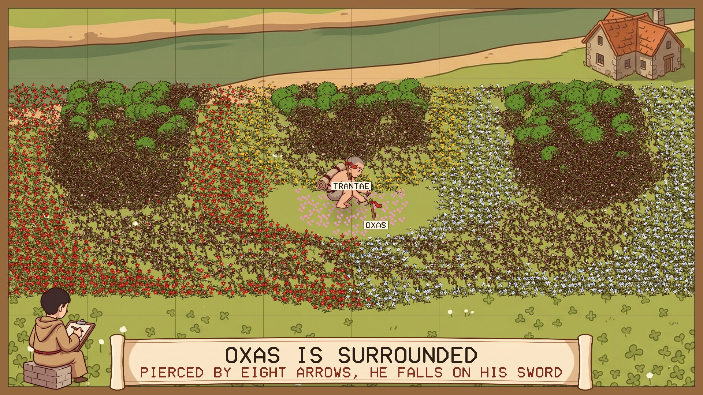
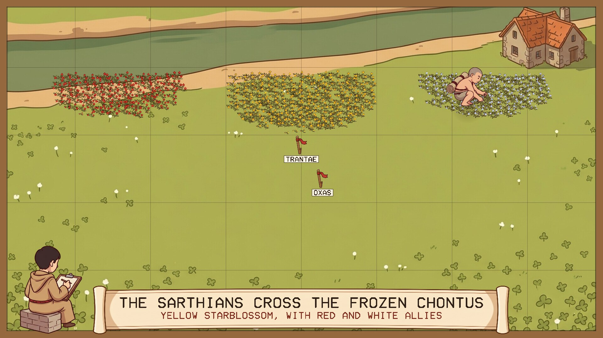
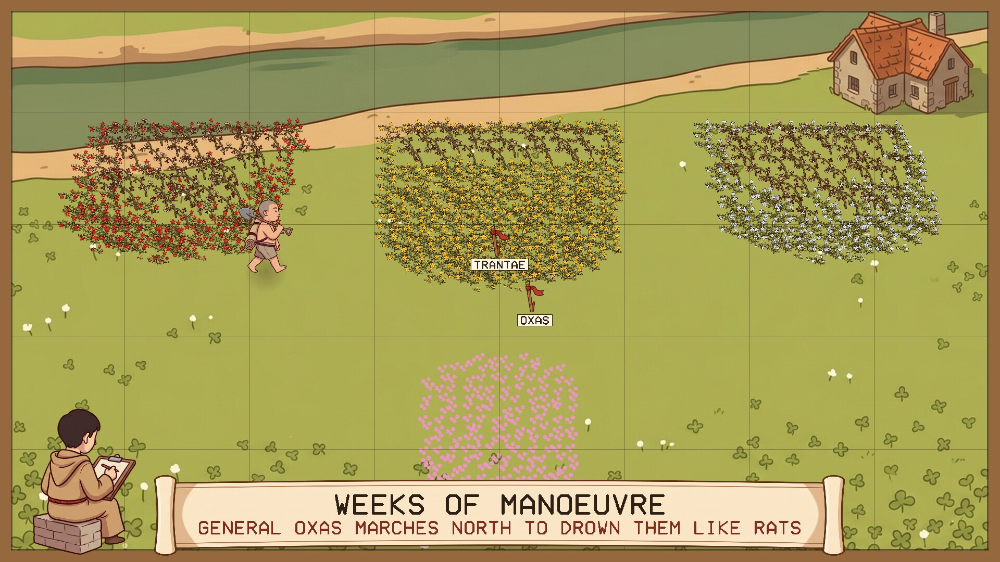
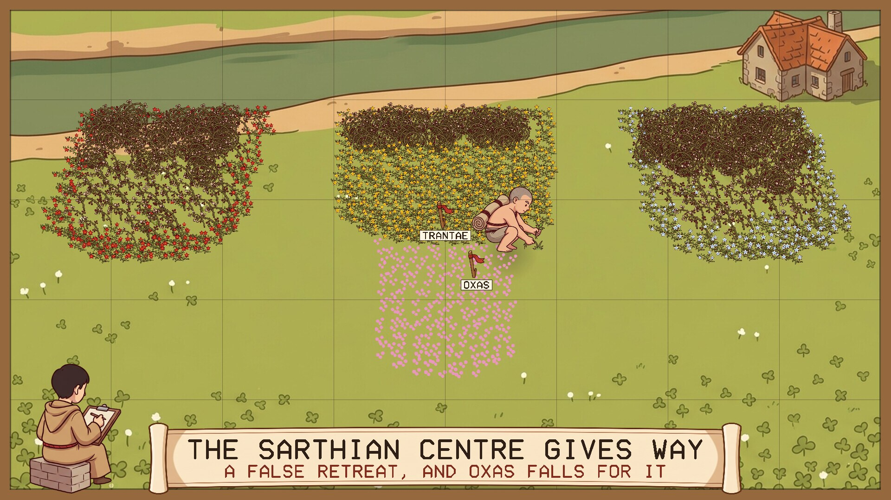
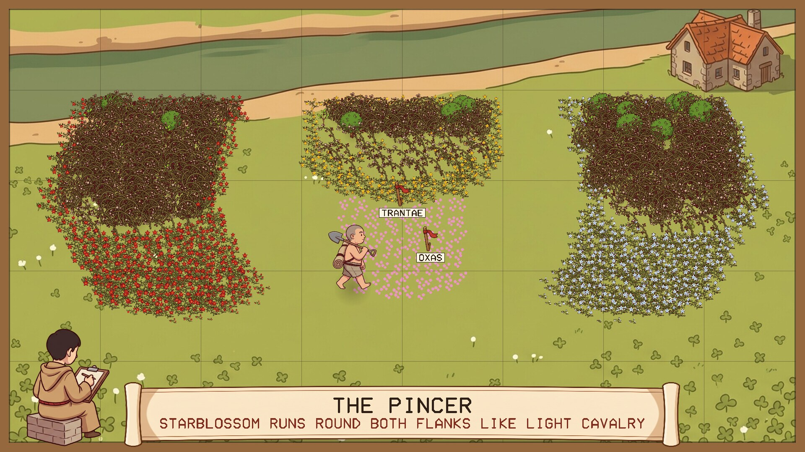
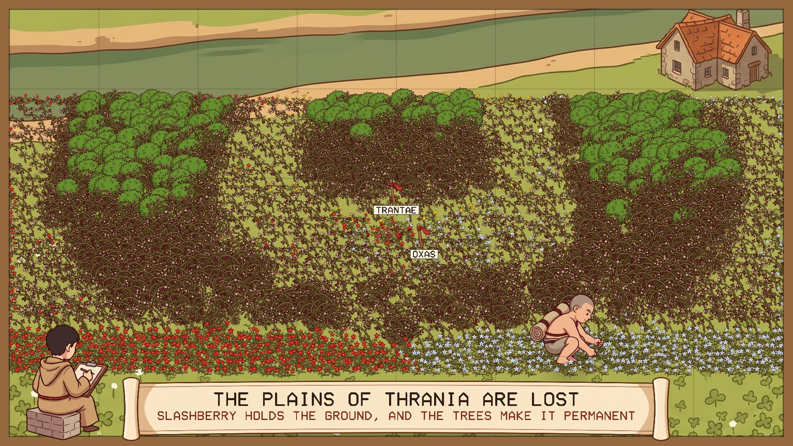
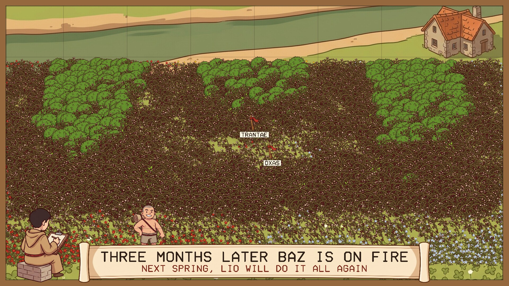

# The Weed War

A screensaver of Lio's weed war, from Neal Stephenson's novel *Anathem*. Runs on
Linux and Windows.

## The story

Fraa Lio is given a patch of meadow to weed as a penance. Instead of clearing it he
uses it to re-enact the Battle of Trantae, with the weeds as armies:

- The clover is the plain. Starblossom, which spreads fast, is the Sarthian cavalry:
  yellow for the Sarthians, red and white for their allies. They cross the river
  from three bridgeheads.
- General Oxas marches north to drive them back into the river. The Sarthian centre
  gives way in a false retreat and Oxas follows it in.
- The red and white wings run round both flanks and meet behind him. Oxas is
  surrounded and falls on his sword.
- Slashberry, slower and thornier, comes up behind the starblossom, and after it
  trees.
- Stakes mark where things happened, and Erasmas sits on the wall drawing it
  through a frame strung with a grid, so that each drawing tallies with the last.

## What the screensaver shows

One year of the war in about two minutes, then winter, then the next year. The
weeds spread from patch to patch by rule: starblossom takes the clover beside it,
slashberry comes up where starblossom is thick, and trees come up through old
slashberry. Lio does not plant anything. He weeds, and where he weeds decides which
way the armies go. He walks to wherever the fighting is and gets to work there.

Every year is different in its details and comes out as Trantae all the same.

| | |
|---|---|
|  |  |
| Three bridgeheads on the near bank | Oxas marches north |
|  |  |
| The centre gives way | Round both flanks |
|  |  |
| The plain overrun | Slashberry and trees behind |

### What is from the book and what is mine

From the book: the battle and its order, starblossom in three colours for the
cavalry, slashberry and trees following, the stakes, Lio weeding it into shape, and
Erasmas drawing it through a grid of strings.

Mine: the book gives Oxas's legions no plant of their own, so here they are clover
in flower, shown in pink. The speed is mine too; in the book it takes a summer.

## Install

Packages are on the [releases page](../../releases).

### Windows

Run `WeedWar-Setup-1.0.1.exe`. It asks for administrator rights, because Windows
only lists screensavers that are in its own system folder. After that "The Weed
War" is in Screen Saver Settings with the others, already selected. Uninstall from
Apps.

### macOS

Download `The-Weed-War-…-mac.zip` from the releases page, unzip it, and open the app. It
runs full screen; any key or a click ends it. It is built for Apple Silicon and
Intel, macOS 11 or later.

The app is not signed with an Apple developer certificate, so the first time macOS
will refuse to open it. Right-click the app and choose Open, or allow it under
System Settings, Privacy & Security. For now it is an ordinary app and not a screen
saver module, so it does not appear in the Screen Saver settings. The Mac build is
made and run on a build machine but has not been tried by a person on a real Mac;
reports are welcome.

### Linux

**Fedora, Nobara** (built on Fedora 44):

    sudo dnf install ./weed-war-1.0.1-1.fc44.x86_64.rpm

**Debian, Ubuntu, Mint** (Ubuntu 24.04 / Debian 13 or later):

    sudo apt install ./weed-war_1.0.1_amd64.deb

From your next login it starts by itself after five minutes idle, and any key or
mouse movement ends it. To start the watcher without logging out, or to change the
delay:

    weed-war-screensaver enable 10    # after 10 minutes idle
    weed-war-screensaver disable
    weed-war-screensaver status
    weed-war-screensaver now          # run it right away

Wayland desktops have no screensaver service to plug into, so the package starts a
small idle watcher (`swayidle`) at login. It works on compositors that provide the
ext-idle-notify protocol: KDE Plasma, Sway, Hyprland, niri, COSMIC, labwc and
others. GNOME does not provide it, and on X11 you would add `weed-war` to
xscreensaver or your desktop's own idle settings. It does not lock the screen. If
one of the other *Anathem* screensavers
([Teglon](https://github.com/mottipython/teglon),
[the Lazy Peregrin](https://github.com/mottipython/lazy-peregrin),
[Cutting the Cake](https://github.com/mottipython/cutting-the-cake),
[the Clock of Saunt Edhar](https://github.com/mottipython/edhar-clock)) is already
on screen it stays out of the way.

## Running it yourself

    weed-war              full screen on every display; any key or mouse movement quits
    weed-war --window     in a window; Esc or Q quits
    weed-war --speed 2    faster
    weed-war --seed 7     a particular year
    weed-war --snapshot out.bmp --time 60 --size 1920x1080

## Building

Needs a C compiler, make and SDL2 (2.0.18 or newer). Build from the top of the
source tree, because the pictures in `assets/art` are built into the program.

    make
    make check
    sudo make install

Packages are written to `dist/`. `tools/Containerfile` describes a container with
everything they need:

    podman build -t anathem-build -f tools/Containerfile tools
    podman run --rm --security-opt label=disable -v "$PWD":/src -w /src anathem-build make dist

## Credits and licence

MIT. *Anathem* and the weed war are Neal Stephenson's; this is an unofficial fan
project.

The pictures (Lio, Erasmas, the plants, the stake, the meadow and the scroll) were
drawn with Google Gemini and prepared by `tools/make_sprites.py`. Images are decoded
with [stb_image](https://github.com/nothings/stb) (public domain).
